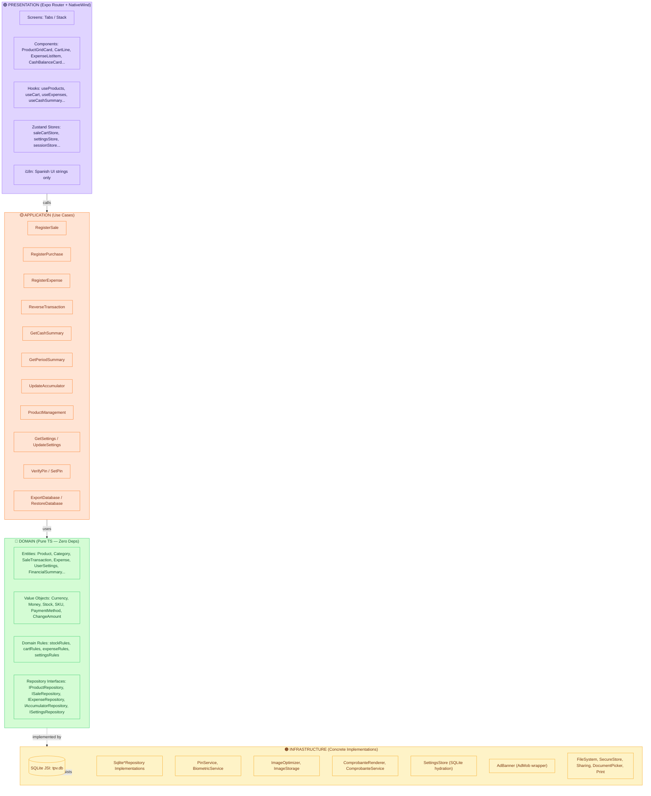

# TPV Móvil Express

> **Point of Sale Mobile Express** — Offline-first, Expo 56, React Native, SQLite JSI, Clean Architecture v2.0.0

[](https://github.com/OWNER/REPO/actions)
[](https://codecov.io/gh/OWNER/REPO)
[](https://expo.dev)
[](https://docs.expo.dev/versions/latest/sdk/sqlite/)
[](https://www.typescriptlang.org)
[](https://www.nativewind.dev)
[](https://shopify.github.io/flash-list/)
[](LICENSE)

---

## 🏗️ Architectural Diagram



---

## ⚙️ Decisiones Clave de Arquitectura

| Decisión | Justificación |
|---|---|
| **Clean Architecture + DDD** | Separación estricta de responsabilidades; Domain puro = testable, portable, sin dependencias de framework |
| **Offline-First SQLite JSI** | `expo-sqlite` API síncrona (`openDatabaseSync`, `withTransactionSync`) → cero latencia, funciona sin red, ACID nativo |
| **Expo 56 + New Architecture** | Hermes + Fabric + TurboModules → rendimiento nativo, hot reload rápido, ecosystem maduro |
| **FlashList v2** | Virtualización real, `numColumns={3}` (catálogo) / `{1}` (listas), sub-50ms render, sin `estimatedItemSize` |
| **Specification-Driven + SemVer** | Cada módulo tiene `spec.md`/`plan.md`/`test.md` versionados `v2.0.0` → contratos claros, migraciones coordinadas |
| **Value Objects compartidos** | `Currency`, `Money`, `Stock`, `SKU` en Domain → invariantes centralizados, no primitivos sueltos |
| **Atomic Transactions** | Todo write use case usa `db.withTransactionSync` → rollback automático, cero descuadres |
| **Singleton Accumulators** | `financial_accumulators` + `settings` (`id=1`, `CHECK`) → lecturas O(1), 0ms cash calculations |
| **Language Governance** | 100% English code/DB/identifiers; Spanish solo en i18n keys → consistencia global, onboarding fácil |
| **AdWare Governance** | Flag `AD_ENABLED` centralizado en `system-settings` → vistas permitidas (Caja, Gastos, Inventario, Movimientos) vs prohibidas (Checkout, Forms, PIN) |

---

## 📦 Module Boundaries (v2.0.0)

| Module | Bounded Context | Key Tables | AdWare |
|---|---|---|---|
| **catalog-inventory** | Products, categories, stock, images | `products`, `categories` | ✅ Inventory list footer |
| **sales-checkout** | Cart, sales/purchases, payment, receipts | `sales_transactions`, `transaction_details` | ❌ Forbidden (checkout flow) |
| **expenses-cashflow** | Expenses, expense categories | `sales_transactions` (type=EXPENSE), `expense_categories` | ✅ Expenses list footer |
| **financial-accumulators** | Cash accumulator, reports, reversal | `financial_accumulators`, `sales_transactions` | ✅ Caja, Movimientos footers |
| **system-settings** | Currency, pagination, PIN/biometric, backup, AD_ENABLED | `settings` (singleton) | 🎛️ Master toggle (`adEnabled`) |

### Cross-Module Contracts
- `catalog-inventory` → `sales-checkout`: Product data (price, stock, SKU)
- `sales-checkout` → `financial-accumulators`: Atomic `UpdateAccumulator` calls
- `expenses-cashflow` → `financial-accumulators`: Atomic `UpdateAccumulator` calls
- `system-settings` → **All**: `Currency`, `Money`, `pageSize`, `adEnabled`, PIN gate

---

## 🗄️ Database Schema (v2.0.0 — English Columns)

```sql
-- products (catalog-inventory)
CREATE TABLE products (
    id INTEGER PRIMARY KEY AUTOINCREMENT,
    category_id INTEGER NOT NULL,
    sku TEXT UNIQUE,
    name TEXT NOT NULL,
    selling_price REAL NOT NULL,
    purchase_price REAL NOT NULL,
    current_stock REAL DEFAULT 0.0,
    min_stock REAL DEFAULT 0.0,
    image_uri TEXT,
    registered_at TIMESTAMP DEFAULT CURRENT_TIMESTAMP,
    updated_at TIMESTAMP DEFAULT CURRENT_TIMESTAMP,
    deleted_at TIMESTAMP DEFAULT NULL,
    FOREIGN KEY(category_id) REFERENCES categories(id)
);

-- categories (catalog-inventory)
CREATE TABLE categories (
    id INTEGER PRIMARY KEY AUTOINCREMENT,
    name TEXT NOT NULL,
    registered_at TIMESTAMP DEFAULT CURRENT_TIMESTAMP,
    deleted_at TIMESTAMP DEFAULT NULL
);

-- sales_transactions (sales-checkout + expenses-cashflow)
CREATE TABLE sales_transactions (
    id INTEGER PRIMARY KEY AUTOINCREMENT,
    type TEXT NOT NULL,              -- 'SALE' | 'PURCHASE' | 'EXPENSE'
    total_amount REAL NOT NULL,
    payment_method TEXT NOT NULL,    -- 'CASH' | 'CARD' | 'TRANSFER' | 'QR'
    detail TEXT,
    registered_at TIMESTAMP DEFAULT CURRENT_TIMESTAMP,
    deleted_at TIMESTAMP DEFAULT NULL
);

-- transaction_details (sales-checkout)
CREATE TABLE transaction_details (
    id INTEGER PRIMARY KEY AUTOINCREMENT,
    transaction_id INTEGER NOT NULL,
    product_id INTEGER NOT NULL,
    quantity REAL NOT NULL,
    unit_price REAL NOT NULL,
    FOREIGN KEY(transaction_id) REFERENCES sales_transactions(id),
    FOREIGN KEY(product_id) REFERENCES products(id)
);

-- financial_accumulators (financial-accumulators)
CREATE TABLE financial_accumulators (
    id INTEGER PRIMARY KEY CHECK (id = 1),
    total_sales REAL DEFAULT 0.0,
    total_purchases REAL DEFAULT 0.0,
    total_expenses REAL DEFAULT 0.0,
    net_balance REAL DEFAULT 0.0,
    updated_at TIMESTAMP DEFAULT CURRENT_TIMESTAMP
);

-- expense_categories (expenses-cashflow)
CREATE TABLE expense_categories (
    id INTEGER PRIMARY KEY AUTOINCREMENT,
    name TEXT NOT NULL,
    registered_at TIMESTAMP DEFAULT CURRENT_TIMESTAMP,
    deleted_at TIMESTAMP DEFAULT NULL
);

-- settings (system-settings)
CREATE TABLE settings (
    id INTEGER PRIMARY KEY CHECK (id = 1),
    currency_code TEXT NOT NULL DEFAULT 'Bs',
    page_size INTEGER NOT NULL DEFAULT 15,
    biometric_enabled INTEGER NOT NULL DEFAULT 0,
    ad_enabled INTEGER NOT NULL DEFAULT 0,
    updated_at TIMESTAMP DEFAULT CURRENT_TIMESTAMP
);
```

---

## 🚀 Quick Start

### Prerequisites
- Node.js ≥ 20
- pnpm ≥ 9
- Expo CLI: `pnpm add -g expo-cli` (or use `pnpm dlx expo`)

### Install & Run

```bash
# Clone
git clone https://github.com/OWNER/REPO.git
cd REPO

# Install dependencies
pnpm install

# Start Expo dev server
pnpm expo start

# Open on:
# - iOS Simulator (press 'i')
# - Android Emulator (press 'a')
# - Physical device (scan QR with Expo Go)
```

### Environment Variables
Create `.env.local` (optional, for remote config):
```env
EXPO_PUBLIC_AD_ENABLED=false
EXPO_PUBLIC_API_URL=https://api.example.com
```

### Database
- Single file: `tpv.db` (created on first run)
- Migrations auto-run via `PRAGMA user_version` on app bootstrap
- v1.0.0 → v2.0.0 migration is zero-data-loss (see `migrations.ts`)

---

## 🧪 Running Tests

```bash
# Unit tests (Domain VOs, Rules, Entities)
pnpm test:unit

# Integration tests (Repositories, Use Cases, SQLite)
pnpm test:integration

# Migration tests (v1→v2 zero-data-loss)
pnpm test:migration

# Hook tests
pnpm test:hooks

# Component tests (React Native Testing Library)
pnpm test:components

# E2E tests (Detox / Maestro) — requires device/emulator
pnpm test:e2e

# All tests + TypeScript + Lint (CI gate)
pnpm test:all
# or
pnpm test && pnpm typecheck && pnpm lint
```

### Test Structure
```
tests/
├── unit/
│   ├── system-settings/        # Currency, Money, UserSettings, settingsRules
│   ├── catalog-inventory/      # Product, Category, Stock, SKU, stockRules
│   ├── sales-checkout/         # CartItem, SaleTransaction, cartRules, ChangeAmount
│   ├── expenses-cashflow/      # Expense, ExpenseCategory, expenseRules
│   └── financial-accumulators/ # FinancialSummary, PeriodSummary
├── integration/
│   ├── system-settings/        # GetSettings, UpdateSettings, VerifyPin, SetPin, Backup
│   ├── catalog-inventory/      # SqliteProductRepository, ProductManagement
│   ├── sales-checkout/         # RegisterSale, RegisterPurchase, RevertTransaction
│   ├── expenses-cashflow/      # RegisterExpense, ReverseTransaction (EXPENSE)
│   ├── financial-accumulators/ # GetCashSummary, GetPeriodSummary, UpdateAccumulator
│   └── security/               # PIN gate, constant-time verify
├── migration/
│   ├── catalog-inventory/
│   ├── sales-checkout/
│   ├── expenses-cashflow/
│   ├── financial-accumulators/
│   └── system-settings/
├── hooks/                      # useProducts, useCart, useExpenses, useCashSummary...
├── components/                 # ProductGridCard, CartLine, ExpenseListItem, CashBalanceCard...
└── e2e/                        # checkoutFlow, pinChangeFlow, backupFlow, adEnabledFlow...
```

---

## 📚 Documentation

| File | Description |
|---|---|
| `AGENTS.md` | Master guidelines for AI agents (this file's v2.0.0 version) |
| `docs/modules/catalog-inventory/spec.md` | Catalog & Inventory specification |
| `docs/modules/sales-checkout/spec.md` | Sales & Checkout specification |
| `docs/modules/expenses-cashflow/spec.md` | Expenses & Cash Flow specification |
| `docs/modules/financial-accumulators/spec.md` | Financial Accumulators specification |
| `docs/modules/system-settings/spec.md` | System Settings specification |

Each module has `/spec.md` (contracts), `/plan.md` (implementation), `/test.md` (TDD suite).

---

## 🔧 Tech Stack Summary

| Layer | Technology |
|---|---|
| **Framework** | Expo SDK 56 (Managed, TypeScript strict) |
| **Router** | Expo Router v5 (file-based) |
| **Styling** | NativeWind v4 + Tailwind CSS (design tokens) |
| **Lists** | `@shopify/flash-list` v2 |
| **Database** | `expo-sqlite` JSI sync (`openDatabaseSync`, `withTransactionSync`) |
| **State** | Zustand (granular selectors, manual invalidation) |
| **Auth** | `expo-secure-store` (PIN SHA-256), `expo-local-authentication` (biometric) |
| **Images** | `expo-image-manipulator` (400×400, JPEG 70%) + `expo-file-system` + `expo-image` |
| **Print/Share** | `expo-print` (HTML) + `expo-sharing` |
| **Backup** | `expo-document-picker` + `expo-file-system` |
| **Dates** | `dayjs` |
| **Toasts** | `react-native-toast-message` |
| **Package Manager** | `pnpm` |

---

## 📋 Global Invariants (Non-Negotiable)

| ID | Rule |
|---|---|
| **INV-01** | Non-negative financial math (Money, Stock, totals) |
| **INV-02** | Soft delete only (`deleted_at`), never hard delete |
| **INV-03** | All multi-table writes atomic via `withTransactionSync` |
| **INV-04** | Single `PaymentMethod` per transaction (no split payments) |
| **INV-05** | Category required for products (`category_id NOT NULL`) |
| **INV-06** | Singleton tables exactly 1 row (`id=1`, `CHECK`) |
| **INV-07** | Stock alerts fire **post-commit** only |
| **INV-08** | Critical actions require PIN (`usePinGate`) |
| **INV-09** | Image pipeline: 400×400, JPEG 70%, target <40KB |
| **INV-10** | Strict TypeScript: `strict`, `noUncheckedIndexedAccess`, `exactOptionalPropertyTypes` |

---

## 🤝 Contributing

1. Read `AGENTS.md` and relevant module `spec.md`
2. Create feature branch: `feat/module-name/short-description`
3. Implement following layer boundaries (Domain → Application → Presentation)
4. Write tests (unit + integration) — target 100% coverage
5. Run `pnpm test && pnpm typecheck && pnpm lint`
6. Open PR with conventional commit messages (`feat:`, `fix:`, `refactor:`)

---

## 📄 License

MIT License — see [LICENSE](LICENSE) for details.

---

*TPV Móvil Express v2.0.0 — Built with Clean Architecture, Offline-First, and ❤️*